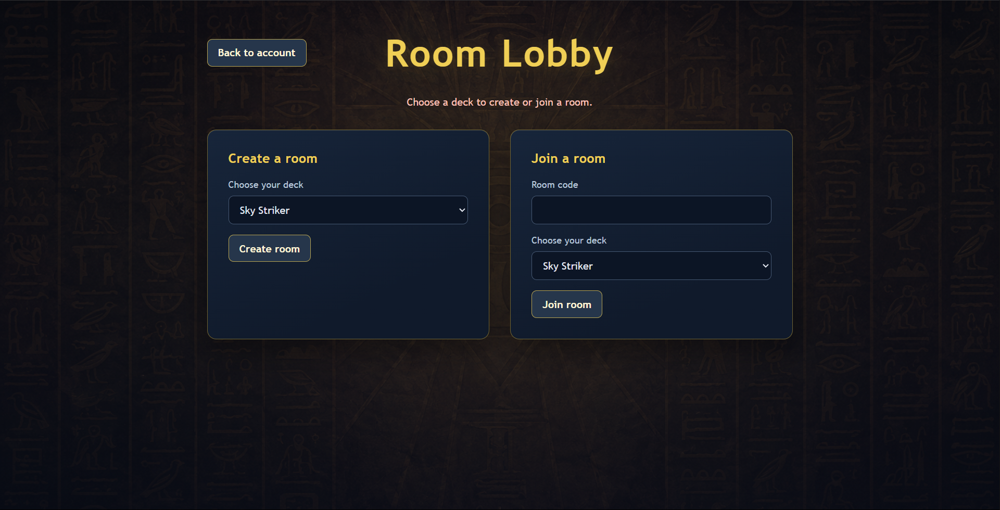
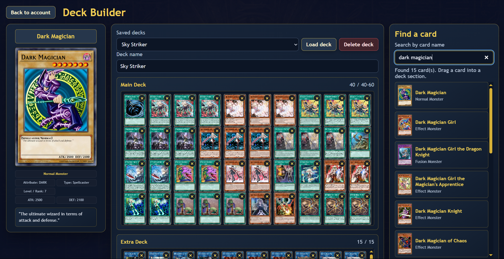
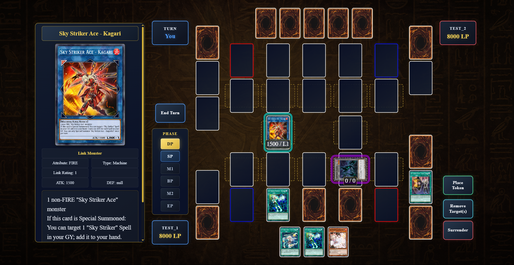
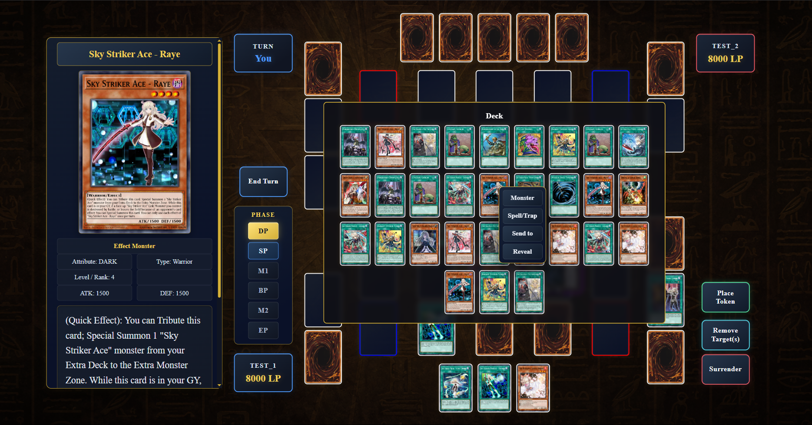
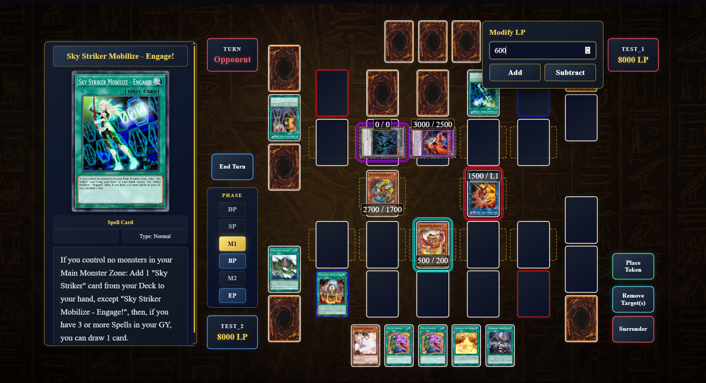

# Yugi

Yugi is a browser-based Yu-Gi-Oh! duel-table prototype with account sign-in, deck building, and a two-player room flow.

Explore my other projects in the [rdimitrov project portfolio](https://github.com/rdimitrovv2922-lab/rdimitrov).

> **Status:** Active prototype. Account, deck-building, room, and board flows are implemented. Players manage card effects manually; the app does not automate the complete Yu-Gi-Oh! ruleset. There is no hosted demo yet.

## Screenshots

| Room lobby | Deck builder |
| --- | --- |
|  |  |
| Create a room or join with a room code and selected deck. | Search the card catalog, inspect cards, and manage saved decks. |

| Duel board | Duel board with deck open |
| --- | --- |
|  |  |
| Track turns, phases, Life Points, and card locations. | View and choose cards from the deck during a duel. |

| Both players' fields |
| --- |
|  |
| View the two duel fields together while the opponent's turn is active. |

## Features

- Register and sign in with accounts persisted in SQLite.
- Search the bundled card catalog and preview card details.
- Build, validate, save, load, and delete Main, Extra, and Side Decks.
- Create or join a two-player room with a short room code.
- Track turns, phases, Life Points, and card locations on the duel board.
- Persist decks, rooms, and room game-state snapshots in SQLite.

## Architecture

- Browser pages use native JavaScript modules and communicate with the server through a JSON API.
- The built-in Node.js HTTP server routes requests to separate authentication, card catalog, deck, and game handlers.
- SQLite stores user records, password hashes, decks, rooms, and room game-state snapshots.
- Passwords are hashed with Node.js `scrypt` using a random salt. Session tokens are managed on the server in memory, so signing in again is required after a server restart.
- Room clients periodically poll the API for room and game-state updates.

## Tech stack

- **Frontend:** HTML, CSS, and browser-native JavaScript modules
- **Backend:** Node.js built-in HTTP server and a project JSON API
- **Storage:** SQLite through Node.js `node:sqlite`
- **Dependencies:** No third-party npm packages; the project uses Node.js built-ins and browser APIs for its server, storage, and client code.

## Run locally

### Requirements

- Node.js 22.13.0 or newer

### Start the app

```bash
git clone https://github.com/rdimitrovv2922-lab/Yugi-app.git
cd Yugi-app
npm start
```

Open [http://localhost:3000](http://localhost:3000), register an account, and build a deck. To try the room flow, open a second browser session, register a second account, then create a room in one session and join it with the room code in the other.

The app creates `server/data/local.sqlite` on first launch. The database is local and ignored by Git.

## Project structure

```text
client/                 Browser pages, styles, game UI, shared rules, and screenshots
server/auth/            Account and session handling
server/cards/           Card catalog loading and API formatting
server/decks/           Deck persistence and validation
server/game/            Multiplayer game-state creation and visibility
server/routes/           Account, card, deck, and room API routes
server/storage/         SQLite schema and migrations
server/data/cards.json  Bundled card catalog
```

## Development notes

This project is being developed as a portfolio application. The core flows are in place, while game rules and card effects are still handled manually by players. Multiplayer updates use periodic HTTP polling. Public deployment is planned after further work on the core functionality; there is no hosted demo at this stage.

## Future development

- **Private room chat:** Add private messaging for the two players in a room.
- **Duel action log and replay support:** Record duel actions chronologically and use each room’s saved deck snapshots to support reviewing past duels and future replays.
- **AI assistant-judge:** Explore a room-aware assistant grounded in Yu-Gi-Oh! rulings that can answer questions about card interactions and chain resolution using the current duel state.

Card names, artwork, and related marks belong to their respective owners. This is an unofficial fan project and is not affiliated with or endorsed by Konami.
